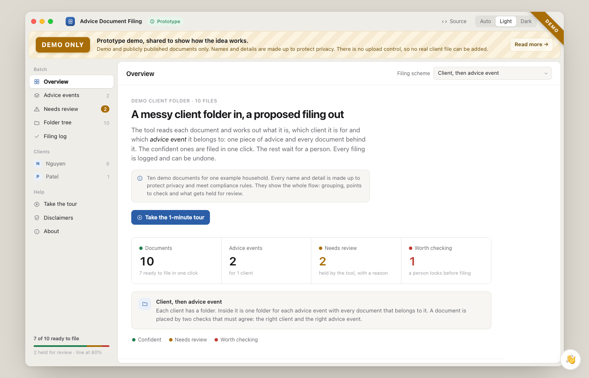
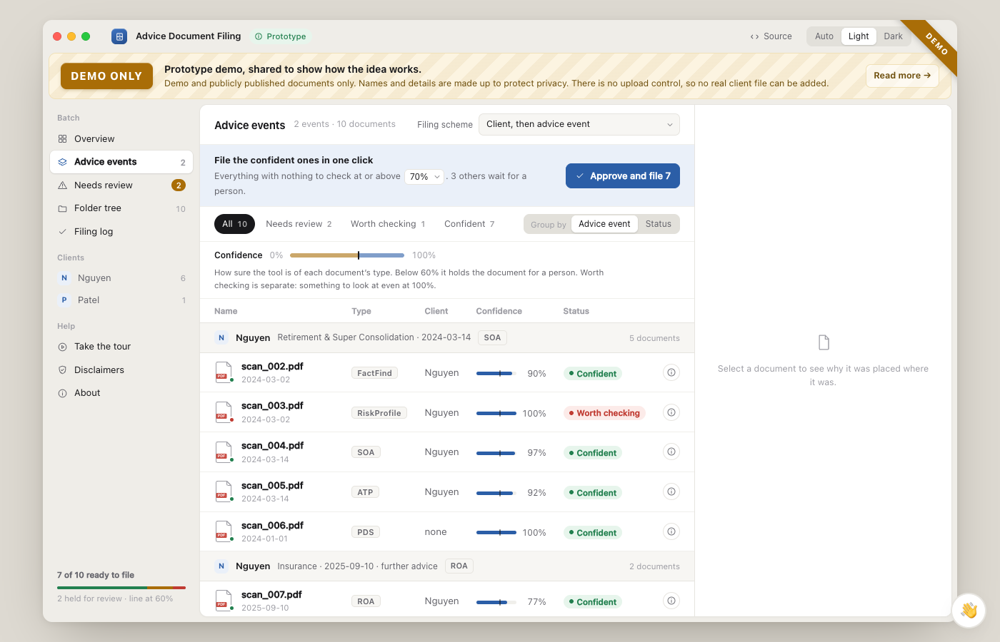
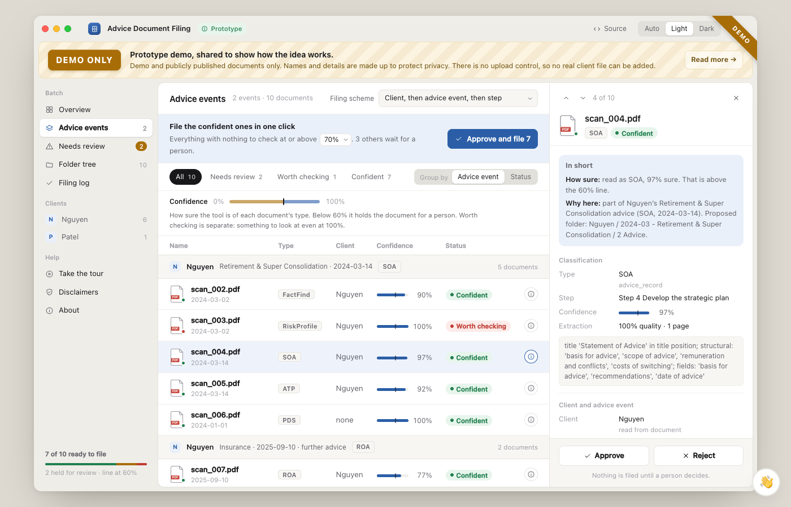
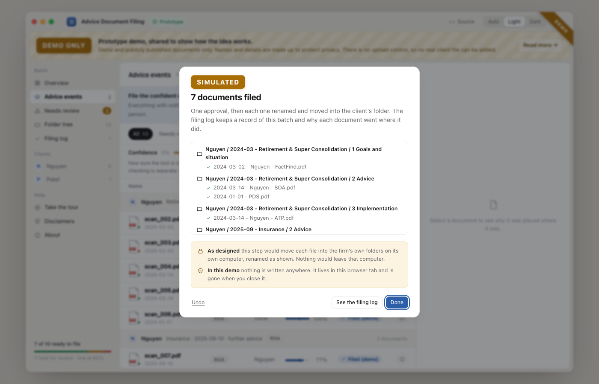
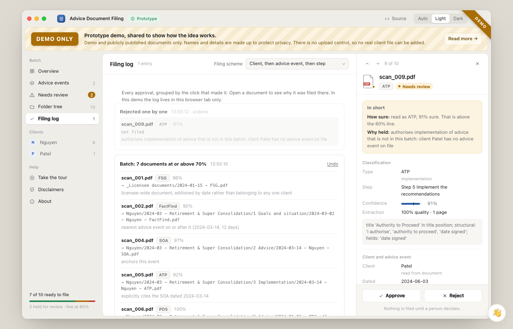
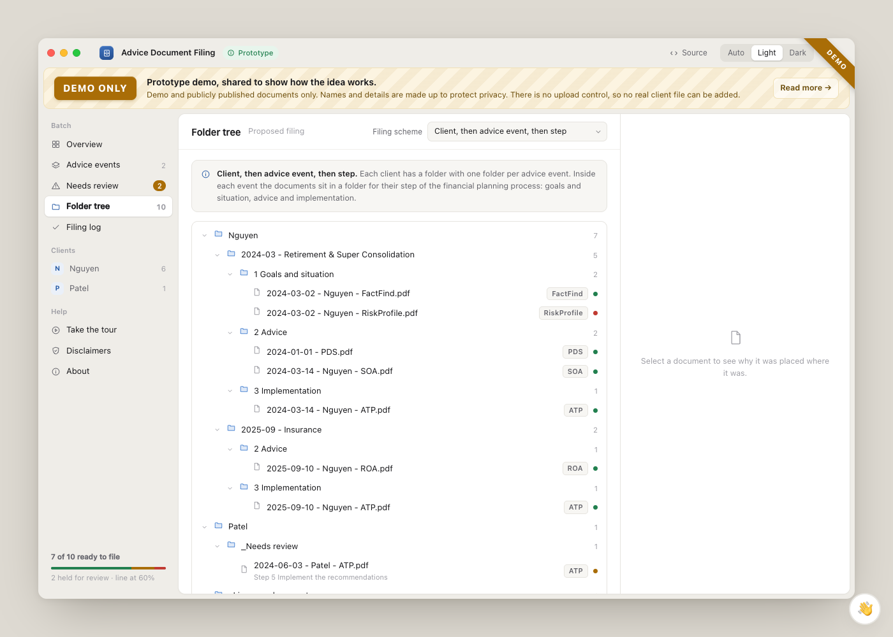

# UI integration plan

How the demo's screens could sit on top of this Python backend, and how a
non-technical person would run it. This is for planning, not a build spec. Nothing
here is decided until Bella and Delia agree on it.

The demo lives in a separate repo, `ahaythorpe/advice-document-classifier`
(`web-react/`, React + Vite, built to one HTML file). It runs on ten made-up
documents with a keyword matcher, not this repo's model. Its public link is
switched off until the real tool is ready (21 Oct 2026).

## The screens

| | Screen | What a person does there |
|---|---|---|
|  | **Overview** | Sees the batch at a glance: how many documents, how many advice events, how many held and how many worth checking. |
|  | **Advice events** | Documents grouped by client and advice event, or by status. A confidence scale shows the line below which nothing is filed. One button files every confident document with nothing to check. |
|  | **Document panel** | Opens from the "Why?" button on any row. "In short" says how sure the tool is and why it chose that folder. The detail is underneath, then Approve or Reject. |
|  | **One-click filing** | After approving a batch: every file and the folder it went to, with Undo. |
|  | **Filing log** | Every approval grouped by the click that made it, with each document's reason. Undo per batch. Undone entries stay in the log. |
|  | **Folder tree** | Client, then advice event, then planning step (#70). The firm can switch filing scheme. |

The rule behind the counts: every document is in exactly one group. Held by the
tool = Needs review. Not held but has a flag = Worth checking. Otherwise Confident.

## What each screen needs from the backend

The backend today takes **one PDF per request** (`POST /ingest`) and returns a
proposal. It writes nothing. The demo assumes a **batch** that is grouped, filed
and logged.

| Screen needs | Backend today | Gap |
|---|---|---|
| Type, verified confidence, evidence | `/ingest` → `classification` (`confidence` is the verified figure, `confidence_raw` the model's) | None |
| Held or not, and why | `/ingest` → `review` from `assess()`, thresholds per type in `review_policy` | The demo shows one line at 60%. The backend has a threshold per type, so the scale should show the type's own line. |
| Flags ("worth checking") | `/ingest` → `flags` | None |
| Step label per document | `/ingest` → `filing.stages` | Names change to the six-step process (#70) |
| Client folder | `filing.client_folder` is always `None` | #6 / PR #69 |
| Advice event folder | `filing.event_folder`, advice records only | Grouping a fact find or ATP into its event needs other documents on hand (#8) |
| Step folder inside the event | Not built | #70 |
| A batch: many documents at once | One file per request | A batch endpoint, or the page loops over `/ingest` and groups locally. Grouping belongs in the backend (#8). |
| Approve and file (one or many) | `/review/correction` records a verdict and files nothing. `storage.py` has `LocalStorage.put()` and nothing calls it. | An approve endpoint that writes through `storage.py`. It must never write from the classifier (ground rule 3). |
| Filing log and undo | `failure_log.jsonl` records corrections only | A filing log (who, when, what moved where, which batch) and an undo that moves a file back |
| Filing schemes | `settings.filing_mode` (#11), PR #28 | Profiles like the demo's `profiles/*.json`, read from the knowledge base |
| Firm rules by chat | Not built | #71 (later) |

## Joining the two

**Suggested:** FastAPI serves the built React page from `static/`, the same way it
serves `static/index.html` today. The page calls the backend's endpoints. That way
it's one program, one port, with no separate web server and no CORS.

- The demo's data shape is close to what `/ingest` returns. The page reads
  `window.DATA` today. It would fetch from the backend instead.
- Keep the page free of document rules. This repo's current page already reads
  types and reasons from `/review/options` (ground rule 1). The demo's status rule and labels would
  move to the knowledge base too.
- Keep the demo build working on sample data with no model. That's the version
  that can be shown to people.

## How a non-technical person would use it

Real client files must stay on the firm's computer (#2, data residency). So the
real tool can't be a public website.

| Option | What they do | Fits |
|---|---|---|
| **A. Private demo link** | Open a link with a password. Sample data only, no model, no upload. | Showing the idea to advisers now. Vercel password protection or an invite list. |
| **B. Desktop app (recommended for real use)** | Download an installer, double-click, a window opens. Pick a folder of documents. | Real documents. The Python backend and the page are bundled into one app (for example PyInstaller or Briefcase, with pywebview for the window). Files never leave the computer. |
| C. Hosted web app | Upload files to a website | Not suitable. Client files would go to someone else's server. |

The hard part of B is the model. The backend needs Ollama and the Llama 3.1
weights (several GB). The installer would need to set those up, or the app would
need to walk the person through it once. That's worth a spike before anything else
in B.

## Suggested order

1. Land the filing basics: #69 (client folder), #70 (step folders), #8 (grouping).
2. A batch endpoint, and an approve endpoint that writes through `storage.py`, with
   a filing log and undo.
3. Serve the React page from FastAPI against those endpoints. Keep a sample-data
   build for demos.
4. Spike packaging as a desktop app, including how Ollama gets installed.
5. Private demo link (A) for advisers once 1 to 3 work on the public sample set.
